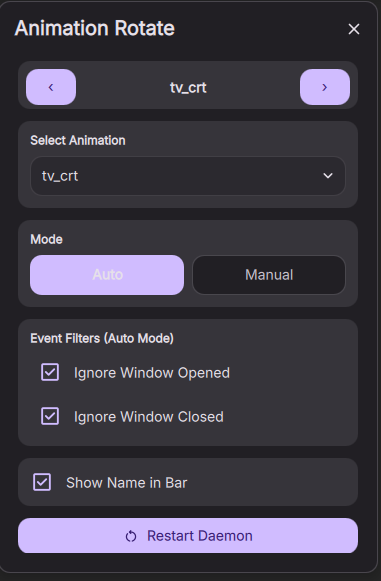

# dms-niri-animation-rotate

Niri window animation rotation control for [Dank Material Shell](https://danklinux.com). Switch animations, toggle auto/manual modes, and filter events — all from the Control Center. **Native DMS daemon — no bundled binaries.**

## How It Works

```
┌──────────────────────────────┐      in-process       ┌──────────────────────────┐
│  DMS Plugin (QML)            │ ◄───────────────────► │  AnimationRotate daemon  │
│  widget + Control Center UI  │   direct QML refs     │  (daemon surface, QML)   │
└──────────────────────────────┘                       └────────────┬─────────────┘
                                                                    │ writes
                                     control.sock (optional,        ▼  animation.kdl
                                     for nrctl / keybinds)   ~/.config/niri/dms/
```

1. **Install** from the DMS Plugin Marketplace (1 click).
2. **Activate** the plugin — DMS creates the daemon surface together with the widget.
3. **Control** your Niri animations from the Control Center, DankBar, or popout widget.
4. **Accept the include** — the first time the plugin asks permission to add `include "dms/animation.kdl"` to your niri config (or add it by hand).

Everything runs inside DMS as QML: the daemon is a *daemon surface* of the plugin, so its lifecycle is tied to the plugin itself (enabled → running, disabled → stopped). There is no external process, no vendored binary, and no polling between widget and daemon — the UI binds directly to daemon state.

## Features

- **Prev/Next buttons** to cycle through Niri window animations
- **Animation picker** — dropdown with all detected animations
- **Auto/Manual mode** — rotate automatically on window events, or manually
- **Event filters** — ignore window-opened or window-closed events
- **Debounce cooldown** — minimum time between automatic rotations
- **Random order** — shuffle presets instead of alphabetical rotation
- **DankBar pill** — shows the current animation name right in the status bar
- **Popout window** — all controls in a dedicated floating panel

## Requirements

- [Niri](https://github.com/YaLTeR/niri) compositor
- Dank Material Shell >= 1.5.0 (native `composite` plugin with a daemon surface)

No Rust toolchain, no binary downloads, no `netcat` (optional — see Keybind Setup).

## Installation

### DMS Plugin Marketplace (recommended)

1. Open DMS → Settings → Plugins → Browse
2. Search for "Animation Rotate"
3. Click Install
4. Activate the plugin — it's ready

### Manual

```bash
git clone https://github.com/pnbarbeito/dms-niri-animation-rotate.git \
  ~/.config/DankMaterialShell/plugins/animationRotate/
```

Then activate the plugin from DMS Settings → Plugins → Local.

### The niri include (one-time, with your consent)

Niri only applies animations through an include in its config file:

```kdl
include "dms/animation.kdl"
```

The plugin **never edits your config silently**. On first activation a card appears in
the Control Center detail view:

- **Add include** — the plugin appends exactly one line to `~/.config/niri/config.kdl`
  (XDG-aware) and remembers your answer. Niri picks the change up automatically.
- **Show instructions** — the plugin stays out of your config and shows you the line to
  add yourself. It won't ask again.

If the include is already there, no card is shown at all.

## Configuration

Open the plugin settings page (right-click the widget → Settings) to adjust:

- **Rotation cooldown** (`cooldown-ms`) — extra debounce on top of each animation's duration
- **Ignore window opened / closed** — event filters for Auto mode
- **Random order** — shuffle the rotation list
- **Control socket path** — override; by default `<pluginDir>/control.sock`, resolved
  through the DMS plugin directory (respects `XDG_CONFIG_HOME`)

All other controls live in the widget UI and apply immediately.

### Keybind Setup (optional)

The daemon serves a Unix control socket compatible with `nrctl` and plain shell
commands. To bind keys for next/prev animation, add custom commands in DMS
Settings → Keybinds (requires netcat with Unix-socket support, e.g. `netcat-openbsd`):

| Action | Command |
|---|---|
| Next animation | `echo 'next' \| nc -U <pluginDir>/control.sock` |
| Prev animation | `echo 'prev' \| nc -U <pluginDir>/control.sock` |

The exact socket path is shown in the plugin settings page.

## Architecture note: the upstream Rust daemon still exists

This plugin used to launch a bundled build of
[niri-animation-rotate](https://github.com/pnbarbeito/niri-animation-rotate) (Rust).
That binary was removed: the daemon logic is now ported to QML and runs inside DMS.
The upstream Rust daemon remains a good **standalone alternative** if you want rotation
outside DMS — it ships its own `nrctl` and releases, and this plugin's control socket
speaks the same command grammar.

## Screenshots



## License

MIT — see [LICENSE](./LICENSE).

## Acknowledgments

The 49 animation presets bundled with this plugin are **not my own work**. They were created by talented authors and collected from the community.

### Authors and sources

- **[chaoscatsofficial@gmail.com](mailto:chaoscatsofficial@gmail.com)** — 16 animations (bloom, burn-ashes, burn, burn-multicolor, explode, fold-window, glitch_00, glitch-cyberpunk, glitch, halftone, pixelate, pop-drop, ribbons, roll-drop, swipe-window, unravel)  
  Source: [XansiVA/nirimation](https://github.com/XansiVA/nirimation)

- **[Justin Garza](mailto:JGarza9788@gmail.com)** — 7 animations (blur, chromatic_edge, energize_b_niri, glide, incinerate, prism_fold, tv_crt)  
  Source: [jgarza9788/niri-animation-collection](https://github.com/jgarza9788/niri-animation-collection)

- **[Joe Hsu](mailto:jhsu.x1@gmail.com)** — 2 animations (dither-glitch, pixel-sort)  
  Source: [jgarza9788/niri-animation-collection](https://github.com/jgarza9788/niri-animation-collection)

- **liixini** ([github.com/liixini](https://github.com/liixini)) — 24 animations (circle, crosshatch, crosswarp, directiona-wipe, directional, disolve, fade, flyeye, glass-warp, glitch_01, heat-melt, ink-splash, inkwell-drop, morph, perlin, pixelfade-wave, plasma-flow, polar-function, polka-dots-curtain, randomsquares, smoke, snap, voronoi-shatter, wave-warp)  
  Sources: [liixini/shaders](https://github.com/liixini/shaders)

Thank you all for sharing your incredible work with the Niri community!

## Related

- [niri-animation-rotate](https://github.com/pnbarbeito/niri-animation-rotate) — the upstream Rust daemon (standalone alternative) and its source code.
